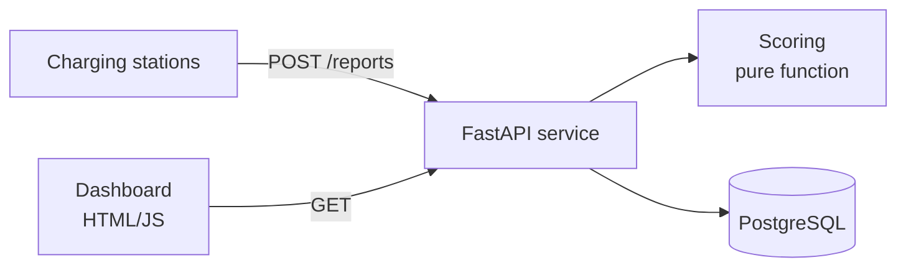
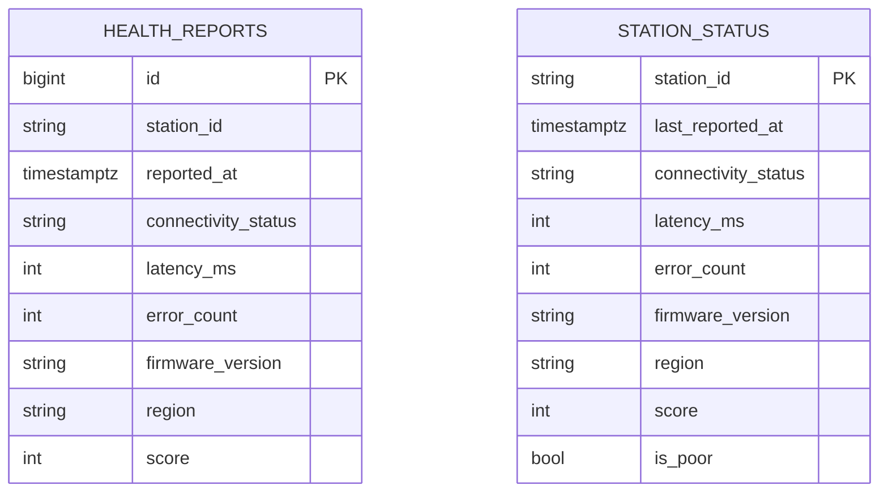
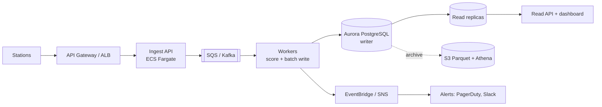
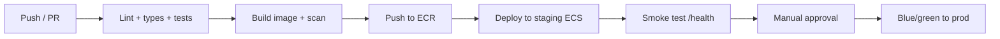

# Design Document: Network Hygiene Service

**Contents:** [1 Architecture](#1-architecture) · [2 Data model](#2-data-model) ·
[3 API design](#3-api-design) · [4 Scaling](#4-scaling-to-100k-stations) ·
[5 Extensions](#5-extensions) · [6 Security](#6-security) · [7 Testing](#7-testing-strategy) ·
[8 CI/CD](#8-cicd) · [9 AWS mapping](#9-aws-mapping) · [10 AI and this design](#10-ai-and-this-design)

---

## 1. Architecture

The exercise is one stateless service plus a relational database. I kept it this
simple on purpose: it is easy to run and reason about, and the scaling section shows
how it grows.

**Layers** (each only talks to the next one):

| Layer | File | Responsibility |
|-------|------|----------------|
| Routes | `main.py` | HTTP, validation, status codes |
| Service | `service.py` | Ingest rules, queries, metrics |
| Scoring | `scoring.py` | Score formula, no I/O, trivial to unit test |
| Persistence | `models.py`, `database.py` | SQLAlchemy tables and sessions |

**Ingest flow:** validate (Pydantic) → compute score → insert into history →
update the station's current status if the report is not older than what we have →
commit, all in one transaction.

**Scoring.** Starts at 100. Offline: -50. Latency over 200 ms: -1 per extra 40 ms
(max -25). Errors: -2 each (max -25). Poor means below 60 (configurable). The weights
are judgement calls and I'd tune them against real incident data. Firmware version is
stored but not scored yet; "behind the latest firmware" is an obvious next penalty.

## 2. Data model

| Table | Purpose | Indexes |
|-------|---------|---------|
| `health_reports` | Append-only history, source for trends | `(station_id, reported_at)` |
| `station_status` | One row per station, the latest state | PK `station_id`, `is_poor`, `region` |

**Why two tables?** "Latest status" and "poor stations" are the hot read paths. With a
separate current-state table they never scan history. The cost is one extra write per
report, which I think is worth it.

**Out-of-order reports** are stored in history but only update `station_status` if
their timestamp is not older than the stored one.

## 3. API design

REST + JSON. FastAPI generates the OpenAPI spec (`/openapi.json`) and Swagger UI (`/docs`).

| Method | Path | Success | Errors |
|--------|------|---------|--------|
| POST | `/reports` | 201, station's new status | 422 invalid input |
| GET | `/stations/{id}/health` | 200 | 404 unknown station |
| GET | `/stations/{id}/history?limit=` | 200, newest first | 404 |
| GET | `/stations/poor` | 200, worst first | |
| GET | `/metrics` | 200, totals and per-region averages | |

Things I'd add next: pagination and a `region` filter on `/stations/poor`, and a
`202 Accepted` response once ingestion goes through a queue.

**Dashboard.** A single static HTML/JS page served by the same service (`/`). It uses
only the public API above, so it could be moved to S3/CloudFront unchanged.

## 4. Scaling to 100K+ stations

At one report per minute per station that is about **1,700 writes/s** and roughly
**150M rows/day**. A single Postgres can take the write rate for a while, but not the
history, and not while serving dashboards.

1. **Decouple ingestion** with a queue. The API validates and enqueues, then returns
   fast. Bursts and DB hiccups no longer drop data.
2. **Batch writes** in workers, with a bulk insert into history and an upsert into `station_status`.
3. **Partition `health_reports` by day.** Keep 30-90 days hot, archive the rest to S3.
4. **Read replicas** for dashboards and metrics. Cache `/metrics` for a few seconds.
5. **Pre-aggregate** regional metrics (materialized view or rollup table) instead of
   computing over the whole fleet on every request.
6. If time-series queries dominate, move history to TimescaleDB or Timestream.

## 5. Extensions

### Proactive alerting
The worker already knows when `is_poor` flips from false to true. Publish a
`station.degraded` event (EventBridge/SNS) and route it to PagerDuty or Slack.
Debounce it (poor for N reports in a row) to avoid noise. A dead station sends
nothing, so also run a scheduled Lambda that finds stations with no report in X
minutes.

### Anomaly detection
Start with statistics, not ML: a rolling mean and standard deviation per station for
latency and errors, flagging anything beyond about 3 sigma. Add fleet-level checks,
such as the error rate grouped by `firmware_version`, to catch a bad rollout. If that
is not enough, run batch jobs on the S3 history or use SageMaker.

### Multi-region redundancy
Active-active ingestion in two regions, each with its own queue and workers. Aurora
Global Database for storage (one writer, fast cross-region replicas), Route 53
latency or failover routing in front. Replaying reports after a failover must be
safe, so I'd add a unique constraint on `(station_id, reported_at)` and make inserts
idempotent. That is not in the code yet.

## 6. Security

| Area | Approach |
|------|----------|
| Device auth | mTLS or per-station API key/JWT issued at provisioning, enforced at API Gateway/ALB |
| Abuse | Per-station rate limiting, WAF, request size limits |
| Input | Pydantic validates types, ranges and enums (done) |
| User auth | OIDC (Cognito/Okta) for the dashboard and read APIs, separate from device auth |
| Secrets | AWS Secrets Manager, never in the repo or image |
| Network | DB in private subnets, TLS everywhere, security groups scoped per service |
| Access | Least-privilege IAM roles per service |
| Supply chain | Dependency and image scanning in CI, pinned versions |
| Dashboard | Station IDs come from devices, so the UI renders them as text, never as raw HTML (done) |

The data holds no personal information, only station IDs and network metrics.

## 7. Testing strategy

| Level | What | Status |
|-------|------|--------|
| Unit | Scoring formula, including caps and boundaries | done |
| Integration | API against a real DB engine: happy path, 404, validation, out-of-order reports, poor listing, history, metrics, dashboard served | done (SQLite in memory) |
| Next | Same suite against Postgres in CI (service container or testcontainers), because SQLite and Postgres treat time zones differently | planned |
| Next | Load test (k6 or Locust) of ingestion at the target rate | planned |
| Next | Contract test from the OpenAPI spec | planned |

I hit the SQLite/Postgres time zone difference while writing the out-of-order logic
(`_as_utc` in `service.py`), which is exactly why the Postgres run matters.

## 8. CI/CD

Today: GitHub Actions runs the tests and builds the Docker image on every push
(`.github/workflows/ci.yml`).

Target pipeline:

Database migrations (Alembic) run as their own step before the new version takes
traffic, and are written to be backward compatible so rollbacks are safe.

## 9. AWS mapping

| Need | Service |
|------|---------|
| Entry point | API Gateway or ALB, with WAF |
| Buffer | SQS (MSK/Kafka if we need replay and high fan-out) |
| Compute | ECS Fargate for the API and workers (EKS if the team already runs it) |
| Database | Aurora PostgreSQL, read replicas, Global Database for DR |
| Archive / analytics | S3 + Athena |
| Alerts | EventBridge / SNS → PagerDuty, Slack |
| Scheduled checks | EventBridge Scheduler → Lambda |
| Observability | CloudWatch, X-Ray or OpenTelemetry |
| Secrets | Secrets Manager |

Lambda suits the scheduled and event-driven jobs. I'd keep the main API and workers on
containers, since steady high-volume traffic is cheaper there than per-invocation pricing.

## 10. AI and this design

Full details are in [AI_USAGE.md](AI_USAGE.md). The short version:

**Validating AI-generated code.** I treat AI output like a pull request from a new
colleague: useful, but reviewed.

- Read every line before committing. If I can't explain it, it doesn't go in.
- Run it: tests, then manual calls through Swagger or curl.
- Check library usage against the official docs (SQLAlchemy 2.0 and Pydantic v2 look
  very different from older examples).
- Look specifically for typical AI mistakes: invented APIs, missing edge cases (time
  zones, out-of-order data), and over-engineering.
- Write or review the tests myself and check that they fail when the behavior is broken.

**How AI influenced the design.** It was a fast way to compare options (queue vs
direct write, one table vs two) and to produce boilerplate. The decisions themselves,
such as the two-table model, "newest report wins" and the scoring weights, are mine.

**Trade-offs.**

| AI-assisted | Manual |
|-------------|--------|
| Fast for boilerplate, tests, config, docs drafts | Better for core rules and anything subtle |
| Can produce plausible code with hidden bugs | Slower, but I understand every line |
| Tends to add more than asked | Keeps scope under control |

For a service this size the net effect is clearly positive, as long as the saved typing
time is partly spent on review. For security-sensitive code I would write the first
version by hand.
